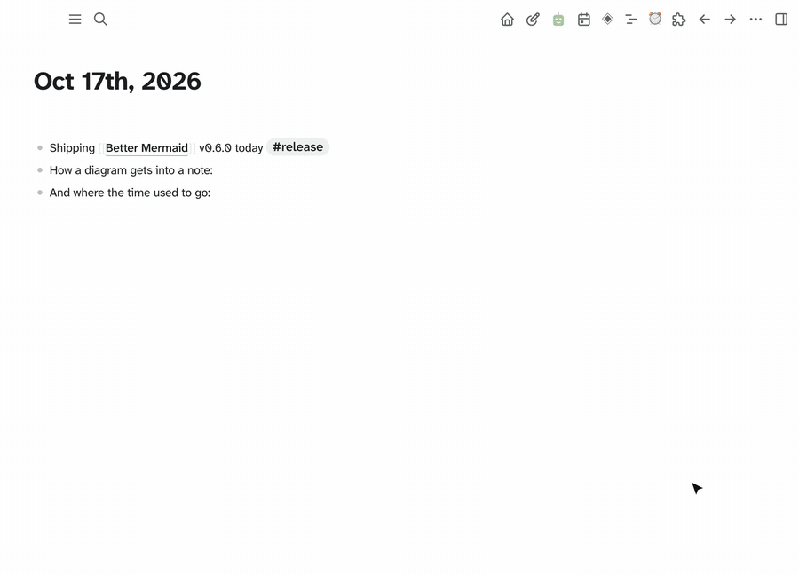
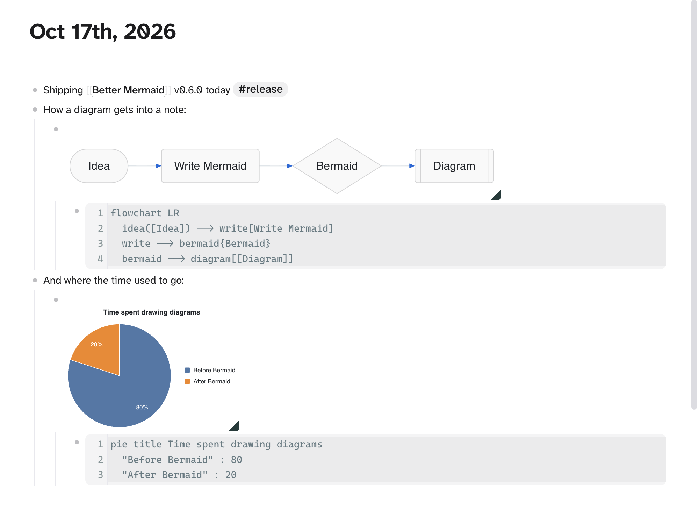
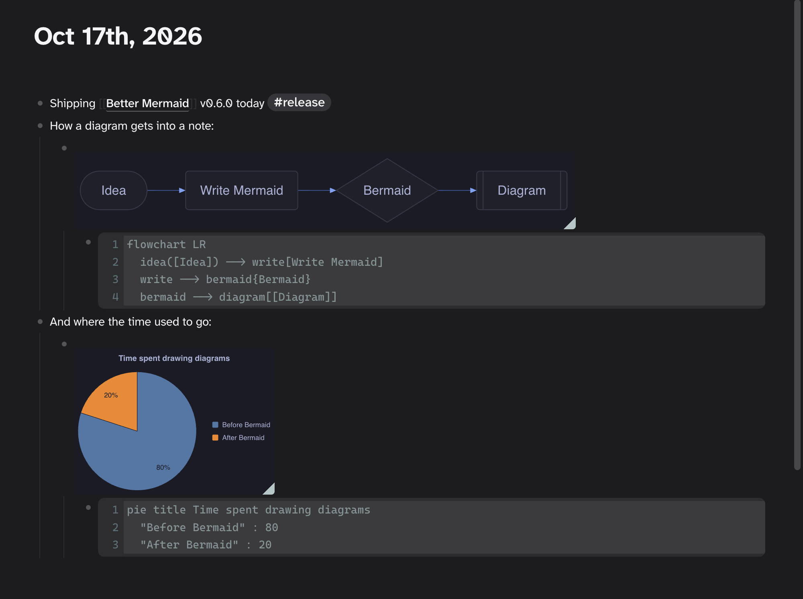
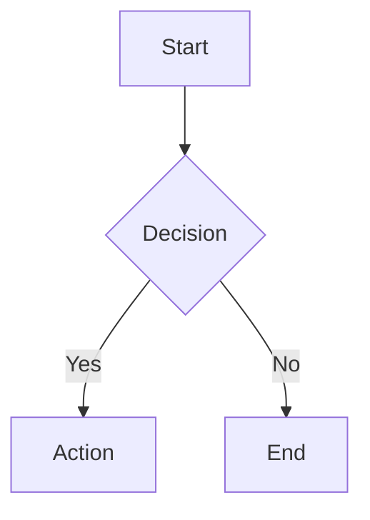

# Bermaid

Bermaid (**Better Mermaid**) is a Logseq plugin that renders Mermaid diagrams with [Pele](https://github.com/obsidianmd/pele) ([npm](https://www.npmjs.com/package/pele)), a fast, lightweight Mermaid renderer that supports every diagram type built into Mermaid 12.1.







## Features

- Render diagrams from `{{renderer :bermaid}}` using child block content
- `/bermaid` slash command to insert an empty diagram block, ready for your Mermaid syntax
- **Render as Bermaid diagram** — right-click the bullet of any Mermaid code block to turn it into a diagram, including code you pasted or wrote before
- Every diagram type built into Mermaid 12.1: flowchart, sequence, class, state, ER, Gantt, pie, mindmap, timeline, C4, kanban, sankey and more
- **Lightbox** — click any diagram to view it full-screen in the same viewer Logseq uses for images (PhotoSwipe): zoom, pan, Esc to close
- Copy rendered diagrams as PNG via hover button
- Drag the corner grip to resize diagrams
- **Live re-render** — edit a diagram's source and the render updates in place when you leave the code block, no reload
- Custom width persists in the macro itself (`{{renderer :bermaid, 500}}`), so it survives in both file-based and DB graphs
- Theme support with `auto` mode that follows Logseq light/dark mode
- Optional transparent background setting

## Install (from source)

1. Install dependencies:

   ```bash
   npm install   # Node 24+ (see .nvmrc)
   ```

2. Build the plugin:

   ```bash
   npm run build
   ```

3. Load into Logseq:
   - **Desktop:** Plugins → **Load unpacked plugin** → select this project folder.
   - **Web (`http://localhost:3001`):** run `npm run serve` and follow the [Development](#development) instructions to load from `http://localhost:8080`.

## Usage

### Quick start with slash command

1. In a block, type `/bermaid` and run the command.
2. Bermaid inserts:
   - `{{renderer :bermaid}}` in the current block
   - An empty ```` ```mermaid ```` code block under it
3. Click into the code block, write your diagram, and press Esc: the diagram appears.

### From an existing code block

1. Make a code block with `/code` (the cursor lands in it), or use one you already have.
2. Type or paste your Mermaid diagram and press Esc.
3. Right-click the block's bullet and choose **Render as Bermaid diagram**.

Bermaid adds `{{renderer :bermaid}}` above the code block and moves the code block under it, unchanged. It works on code blocks marked `mermaid` and on code blocks with no language whose content is a Mermaid diagram; anything else is left alone.

### Manual macro

Create a block:

```text
{{renderer :bermaid}}
```

Add Mermaid syntax in child blocks, for example:



## Interactions

- **Lightbox**: click the diagram to view it full-screen; press Esc, click the backdrop, or click the ✕ button to close
- **Zoom**: mouse wheel or pinch to zoom toward the cursor, up to 8× the fitted size; click the zoom button or the diagram itself to toggle 2×
- **Pan**: click-drag the diagram (or scroll) when zoomed in
- **Copy as PNG**: hover and click the copy button
- **Resize**: drag the grip in the diagram's bottom-right corner; the width is written back into the macro as `{{renderer :bermaid, NNN}}`
- **Edit**: change the Mermaid source in the child block and the diagram re-renders in place

## Settings

- **Theme**: `auto` (follows Logseq light/dark mode) or a named theme: Tokyo Night, Catppuccin, Nord, Dracula, GitHub, Solarized, One Dark and more
- **Transparent Background**: controls SVG/PNG background transparency

## Development

Development requires two concurrent processes:

- **File watcher** — rebuilds `dist/` on every save:

  ```bash
  npm run watch
  ```

- **Dev HTTP server** — serves the plugin at `http://localhost:8080`:

  ```bash
  npm run serve
  ```

Then in Logseq (Developer mode enabled): Plugins → ⋮ → "Load plugin from web url" → `http://localhost:8080`.

- Production build:

  ```bash
  npm run build
  ```

## Publish on GitHub

This repository includes `.github/workflows/publish.yml`.

- Create and push a version tag (for example `v0.1.0`)
- GitHub Actions builds the plugin and creates `logseq-bermaid.zip`
- The workflow uploads the zip to the GitHub release for that tag

Example:

```bash
git tag v0.2.1
git push origin v0.2.1
```

## Publish to Logseq Marketplace

Detailed steps and a manifest template are in [docs/MARKETPLACE_SUBMISSION.md](docs/MARKETPLACE_SUBMISSION.md).

> Marketplace review requires at least one screenshot or animated GIF in the README showing the plugin in action.

## Credits

- [**Pele**](https://github.com/obsidianmd/pele) by [Obsidian](https://github.com/obsidianmd) — the SVG rendering engine that does the heavy lifting: parsing, layout and drawing for every Mermaid diagram type.
- [**beautiful-mermaid**](https://github.com/lukilabs/beautiful-mermaid) by [lukilabs](https://github.com/lukilabs) — Bermaid's engine up to v0.5; its color themes and the way it derives fills, borders and arrow colors live on in Bermaid's theme setting.
- [**Mermaid**](https://github.com/mermaid-js/mermaid) — the diagramming language.

## License

MIT
